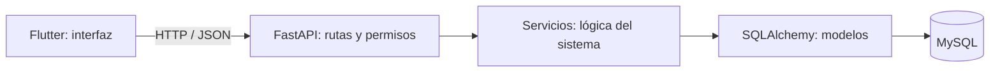

# SaludMayor Blog

Blog de información sobre salud, bienestar y cuidado de las personas adultas mayores. Proyecto académico de Trayectoria Vital, S. A. de C. V., desarrollado en la Universidad Tecnológica de Querétaro (UTEQ), durante el cuatrimestre septiembre–diciembre de 2026.

## Objetivo y alcance

Facilitar el acceso a publicaciones informativas y la interacción entre usuarios registrados mediante comentarios, valoraciones, reacciones y mensajería privada, con una interfaz clara y control de acceso por roles. La administración de publicaciones corresponde exclusivamente al administrador. El contenido es informativo y no sustituye la atención médica profesional. El comercio electrónico no forma parte del alcance.

## Equipo de desarrollo

- Juan Pablo Morua Balderas.
- Diego Fernando Ruelas Bolaños (líder del proyecto).

Licenciatura en Ingeniería en Tecnologías de la Información e Innovación Digital — Grupo LITIID013.

## Funcionalidades

| Función | Usuario registrado | Administrador |
| --- | --- | --- |
| Inicio y cierre de sesión, perfil y recuperación de contraseña | Sí | Sí |
| Consultar y buscar publicaciones por categoría | Sí | Sí |
| Comentar, valorar y reaccionar a comentarios | Sí | Sí |
| Eliminar comentarios propios | Sí | Sí |
| Mensajería privada | Sí | Sí |
| Crear, editar y eliminar publicaciones | No | Sí |
| Moderar comentarios | No | Sí |
| Administrar cuentas y categorías | No | Sí |
| Configurar nombre y logotipo del blog | No | Sí |
| Panel administrativo | No | Sí |

El registro público crea únicamente cuentas de usuario normal. Cada usuario puede asignar una valoración de 1 a 5 por publicación y una reacción por comentario. La recuperación utiliza una clave de un solo uso generada previamente, no un servicio de correo electrónico.

## Tecnologías

| Componente | Tecnología |
| --- | --- |
| Interfaz | Flutter, Dart, Material Design |
| API REST | Python, FastAPI, Uvicorn |
| Base de datos | MySQL 8.0, InnoDB, utf8mb4 |
| Acceso a datos | SQLAlchemy, PyMySQL |
| Validaciones | Pydantic, Pillow |
| Seguridad | JWT, Argon2id, cookies HttpOnly, almacenamiento seguro nativo |
| Control de versiones | Git y GitHub |

## Arquitectura



Flutter presenta la interfaz y consume la API mediante sus servicios. FastAPI valida las solicitudes y permisos; los servicios implementan las operaciones del sistema y SQLAlchemy comunica el backend con MySQL. El frontend no accede directamente a la base de datos.

## Estructura del repositorio

```text
SaludMayor/
├── README.md
├── .gitignore
├── database/
│   ├── saludmayor_blog.sql
│   ├── datos_iniciales.sql
│   └── migracion_3181.sql
├── backend_API/
│   ├── core/                 # Configuración, seguridad y dependencias
│   ├── routers/              # Endpoints de la API
│   ├── services/             # Operaciones y reglas del sistema
│   ├── database.py           # Conexión con MySQL
│   ├── models.py             # Modelos SQLAlchemy
│   ├── schemas.py            # Validaciones Pydantic
│   ├── main.py               # Entrada de FastAPI
│   ├── .env.example
│   ├── requirements.txt
│   ├── requirements.lock.txt
│   └── test_*.py             # Pruebas
└── flutter_application_1/
    ├── lib/
    │   ├── core/              # Cliente HTTP y sesión
    │   ├── models/            # Modelos de datos
    │   ├── screens/           # Pantallas
    │   ├── services/          # Consumo de API
    │   ├── theme/             # Identidad visual
    │   ├── widgets/           # Componentes reutilizables
    │   └── main.dart
    ├── test/
    ├── web/
    └── pubspec.yaml
```

## Instalación local (Windows / PowerShell)

### 1. Requisitos

Entorno utilizado durante el desarrollo: Windows 11, Python 3.14.5, Flutter 3.47.5, Dart 3.13.4 y MySQL 8.0.46. Instalar también Git y Google Chrome. Flutter incluye Dart. Verificar con `python --version`, `flutter doctor`, `git --version` y `mysql --version` (si MySQL está en PATH).

Descargar o clonar este repositorio desde su página de GitHub mediante **Code**, abrir PowerShell en la carpeta raíz `SaludMayor` y conservar la estructura de carpetas.

### 2. Crear la base de datos

Estas instrucciones son para una instalación nueva. No ejecutarlas sobre una base existente con información sin hacer respaldo. Iniciar el servicio de MySQL. Desde la raíz del proyecto:

```powershell
chcp 65001
& "C:\Program Files\MySQL\MySQL Server 8.0\bin\mysql.exe" -u root -p --default-character-set=utf8mb4
```

Si MySQL está instalado en otra ubicación, ajustar la ruta del ejecutable. Dentro de la consola MySQL, ejecutar:

```sql
SOURCE database/saludmayor_blog.sql;
SOURCE database/datos_iniciales.sql;
```

Crear una cuenta de aplicación con permisos limitados. Sustituir `REEMPLAZAR_POR_CLAVE_PRIVADA` por una contraseña segura propia antes de ejecutar:

```sql
CREATE USER 'saludmayor_app'@'localhost' IDENTIFIED BY 'REEMPLAZAR_POR_CLAVE_PRIVADA';
GRANT SELECT, INSERT, UPDATE, DELETE ON saludmayor_blog.* TO 'saludmayor_app'@'localhost';
USE saludmayor_blog;
SHOW TABLES;
EXIT;
```

Se esperan diez tablas: usuario, categorias, blog, comentarios, valoraciones, tipo_reaccion, reacciones, mensajes, configuracion y sesiones. El script de estructura ya incorpora `recuperacion_hash`; `migracion_3181.sql` se reserva para instalaciones anteriores que todavía no tienen esa columna. No ejecutarlo en una instalación nueva.

### 3. Configurar el backend

Desde la raíz del proyecto, en PowerShell:

```powershell
cd backend_API
python -m venv venv
.\venv\Scripts\Activate.ps1
python -m pip install -r requirements.lock.txt
Copy-Item .env.example .env
python -c "import secrets; print(secrets.token_hex(32))"
notepad .env
```

Copiar el valor generado al campo `JWT_SECRET_KEY` y establecer `DB_PASSWORD` con la contraseña de MySQL creada en el paso anterior. Conservar las demás variables de `.env.example`, incluyendo `CORS_ORIGINS` y `ALLOWED_HOSTS`. Los valores principales para desarrollo local son:

```dotenv
DB_HOST=localhost
DB_PORT=3306
DB_USER=saludmayor_app
DB_PASSWORD=REEMPLAZAR_POR_CLAVE_PRIVADA
DB_NAME=saludmayor_blog
JWT_SECRET_KEY=REEMPLAZAR_POR_VALOR_GENERADO
CORS_ORIGINS=["http://localhost:8080"]
COOKIE_SECURE=false
```

No publicar `.env`. Estos valores de ejemplo no son credenciales reales. Si PowerShell bloquea la activación del entorno, se puede invocar ` .\venv\Scripts\python.exe` directamente (sin el espacio inicial) en lugar de `python`.

Comprobar la conexión y arrancar la API:

```powershell
python test_connection.py
python test_models.py
python -m uvicorn main:app --reload --host localhost --port 8000
```

Mantener esta terminal abierta.

| Recurso | URL local |
| --- | --- |
| API | http://localhost:8000/ |
| Swagger UI | http://localhost:8000/docs |
| ReDoc | http://localhost:8000/redoc |

### 4. Ejecutar Flutter Web

Abrir otra terminal PowerShell en la raíz del proyecto:

```powershell
cd flutter_application_1
flutter pub get
flutter run -d chrome --web-hostname localhost --web-port 8080
```

Abrir http://localhost:8080 si Chrome no se abre automáticamente. Usar `localhost` en ambos servicios para mantener un origen y configuración de cookies compatibles con el desarrollo local. La URL de la API se puede cambiar mediante `--dart-define=API_BASE_URL=...`; en ese caso también deben ajustarse los orígenes y hosts permitidos cuando corresponda.

## Cuentas de demostración

Disponibles tras importar `datos_iniciales.sql` en una base nueva. Son cuentas ficticias para evaluación local, no para producción.

| Rol | Correo | Contraseña de demostración |
| --- | --- | --- |
| Administrador | admin@saludmayor.example | SMdemo!12026 |
| Usuario | maria@saludmayor.example | SMdemo!22026 |
| Usuario | carlos@saludmayor.example | SMdemo!32026 |
| Usuario | ana@saludmayor.example | SMdemo!42026 |

El administrador puede gestionar el contenido y los usuarios. Las cuentas normales permiten comprobar comentarios, valoraciones, reacciones y mensajes entre usuarios. Para utilizar la recuperación de contraseña, generar primero una clave desde el perfil y conservarla de forma privada.

## Pruebas y compilación

### Backend

Con Uvicorn activo, abrir otra terminal en `backend_API`, activar el entorno virtual y ejecutar:

```powershell
.\venv\Scripts\Activate.ps1
python test_backend.py
```

Escribir `PRUEBAS` cuando se solicite y proporcionar las credenciales de las cuentas de prueba que indique cada script. El ejecutor integra 16 scripts y realiza pausas de 61 segundos para respetar el límite de autenticación. Utilizar exclusivamente una base de pruebas respaldada: las pruebas pueden crear o modificar registros y sesiones.

### Frontend

Desde `flutter_application_1`:

```powershell
flutter analyze
flutter test
flutter build web
```

El último comando genera la versión web en `build/web/`. Esta compilación no equivale a desplegar la aplicación en un servidor público.

## Seguridad y consideraciones de despliegue

- Contraseñas y claves de recuperación protegidas mediante Argon2id.
- Autenticación JWT con expiración y revocación de sesiones.
- Cookies HttpOnly para web y almacenamiento seguro de tokens en plataformas nativas.
- Validación de permisos en el servidor y control de acceso a mensajes privados.
- Validación del origen de solicitudes, hosts permitidos y límite de solicitudes de autenticación.
- Validación de tamaño y formato de imágenes (JPEG, PNG y WebP).
- Variables sensibles fuera del repositorio y permisos limitados para MySQL.

Antes de un despliegue público, configurar HTTPS, cookies seguras, orígenes y hosts reales, secretos nuevos, respaldo de datos y eliminar o sustituir las cuentas de demostración. El repositorio documenta una instalación local; no presupone que exista un servicio público en funcionamiento.

## Documentación de referencia

- Acta de Inicio de SaludMayor.
- Solicitud de Requerimientos Funcionales (RQ001–RQ010).
- Solicitud de Requerimientos No Funcionales (RNF001–RNF003).
- Documentación de diseño de interfaces.

Proyecto académico — Universidad Tecnológica de Querétaro, 2026.
